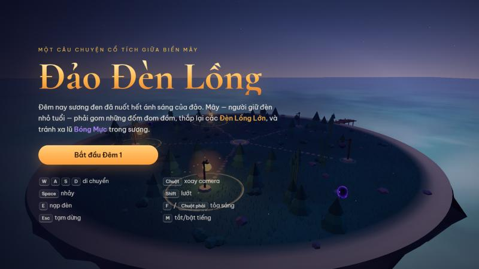

# Đảo Đèn Lồng

> Video demo: *(sẽ thêm ở Phase 4)* · Tài liệu lab gốc: [LAB.md](LAB.md) · [CHANGELOG](CHANGELOG.md) · Spec: [Phase 2](docs/notes/phase-2-spec.md), [Phase 3](docs/notes/phase-3-spec.md) · [ADR-001 dầu đèn](docs/notes/adr-001-lantern-fuel.md)

Game 3D góc nhìn thứ ba. Mây, người giữ đèn nhỏ tuổi đội nón lá, đi qua **ba hòn đảo giữa biển mây** trong ba Đêm. Mây gom đom đóm để thắp các Đèn Lồng Lớn, châm dầu để đèn không tắt, và đuổi lũ Bóng Mực hút dầu trong sương đen, **giữ đủ đèn sáng tới bình minh**. Thắng cả ba Đêm thì màn Bình Minh hiện tổng điểm. Bản web dùng Three.js. Logic game là một lõi mô phỏng tất định, chạy được cả trong trình duyệt lẫn Node (headless).




## Cài đặt và chạy (macOS / Linux / Windows, cần Node ≥ 18)

```bash
npm ci
npm start
```

Trình duyệt mở `http://localhost:5173`. Bản tĩnh để phát hành: `npm run build`, kết quả nằm trong thư mục `dist/`.

## Điều khiển

| Phím | Hành động |
|---|---|
| W A S D / mũi tên | Di chuyển (theo hướng camera) |
| Chuột (bấm vào màn hình để khóa chuột) | Xoay camera · lăn chuột để zoom |
| Space | Nhảy |
| Shift | Lướt |
| E | Thắp đèn / thắp lại / châm dầu (khi đứng trong 2 m quanh chân cột) |
| F / chuột phải | Tỏa Sáng (tốn 3 đom đóm) |
| Esc / P | Tạm dừng: Tiếp tục / Chơi lại Đêm / âm lượng, độ nhạy chuột, **bảng màu dễ phân biệt** (được lưu lại) / Về menu |
| M | Tắt/bật tiếng |

## Ba Đêm

| Đêm | Đảo | Đèn (cần sáng lúc bình minh) | Thời gian | Điểm đặc biệt |
|---|---|---|---|---|
| 1 | Đảo Bến: đảo tròn r = 40 m | 5 (3) | 240 s | Bến gỗ, thuyền nhỏ |
| 2 | Đảo Cau: hai đảo r = 28 m | 6 (4) | 270 s | Cầu tre không lan can, 2 bục nhảy bắn sang đảo bên kia, Gió Lạc, Bùa Gió |
| 3 | Đảo Chuông: đảo r = 45 m, 3 tầng | 7 (5) | 300 s | Vách tầng, 2 dốc, bục nhảy lên tầng cao, tháp chuông, gió mạnh mỗi 30 s, Bóng Mực nhanh hơn |

Menu chính có nút **Bắt đầu hành trình** (Đêm 1 → 3) và nút chọn thẳng từng Đêm. Thắng một Đêm thì sang Đêm kế. Thua thì chơi lại Đêm đó.

## Luật và cách tính điểm (số chuẩn Ticket-02, luật dầu Ticket-03)

- Chạy 6 m/s; nhảy 7 m/s (trọng lực −20 m/s²); lướt 14 m/s trong 0.2 s, hồi chiêu 1.5 s.
- Sức chứa đom đóm = 10 + 2 × số lần thắp thành công trong Đêm, tối đa 20.
- Thắp lần đầu cần 10 đom đóm. Nạp nhiều lần được, đèn nhớ tiến độ.
- **Dầu đèn:** đèn vừa thắp có 100 dầu, hao 1 dầu/giây. Bấm E ở đèn đang sáng để châm: mỗi đom đóm +10 dầu, tối đa 100. Hết dầu thì đèn tắt; đèn đã từng sáng chỉ cần 5 đom đóm để thắp lại.
- **Đèn dưới 30 dầu mất vùng an toàn**, nhấp nháy chậm. Bóng Mực tìm tới đèn yếu và **hút** 5 dầu/giây. Tỏa Sáng hoặc châm dầu lên ≥ 30 để đuổi chúng.
- Bóng Mực chạm vào: −1 Ngọn Lửa, rơi một nửa số đom đóm đang mang ra xung quanh (nhặt lại được trong 8 s), bất tử 1.5 s.
- Rơi khỏi đảo: −1 Ngọn Lửa, mất hết đom đóm, hồi sinh ở điểm xuất phát sau 1 s.
- Tỏa Sáng: tốn 3 đom đóm, hồi chiêu 3 s. Choáng Bóng Mực trong 5 m trong 2 s và đẩy lùi 4 m. Trúng Gió Lạc đang đuổi thì nó bỏ chạy; trúng Gió Lạc đang mang đồ cướp được thì nó đánh rơi lại.
- Đèn sáng còn ≥ 30 dầu tạo vùng an toàn bán kính 6 m, Bóng Mực không vào được.
- **Gió Lạc** (Đêm 2, 3): đuổi khi Mây mang ≥ 5 đom đóm, chạm vào thì cướp 3 con rồi bỏ chạy. Không làm mất Ngọn Lửa.
- **Bùa Gió** (lá bùa đỏ viền vàng): trong 10 s chạy 7.2 m/s và lướt không cần hồi chiêu. Bùa xuất hiện lại sau 45 s.
- **Thắng:** còn sống lúc bình minh (hết giờ) và số đèn đang sáng ≥ 60% số đèn (3/5, 4/6, 5/7). Thắp đủ đèn sớm không kết thúc Đêm.
- **Thua:** hết 3 Ngọn Lửa (ngay lập tức), hoặc trời sáng mà đèn sáng dưới ngưỡng. Ngọn Lửa hồi đầy ở đầu mỗi Đêm.

| Sự kiện | Điểm |
|---|---|
| Mỗi đom đóm nạp vào đèn (thắp, thắp lại, châm dầu) | +5 |
| Thắp lần đầu | +100 |
| Thắp lại | +40 |
| Bóng Mực trúng Tỏa Sáng | +5 (+15 nếu nó đang hút dầu) |
| Bình minh (chỉ khi thắng): mỗi đèn đang sáng | +50 + số dầu còn lại (làm tròn xuống) |
| Bình minh (chỉ khi thắng): mỗi Ngọn Lửa còn lại | +50 |

Tổng điểm của hành trình là tổng điểm các Đêm đã thắng.

## Chế độ headless (Test Contract v1.2)

```bash
node tools/headless.mjs --seed 1 --night 1 --ticks 18000 --out out.jsonl [--scenario s.json] [--inputs i.json] [--snapshot-every 10]
```

- `--night` nhận 1, 2 hoặc 3. Khai báo đầy đủ trong [game.contract.json](game.contract.json). Các số `tuning` lấy trực tiếp từ [src/sim/config.js](src/sim/config.js); test kiểm tra hai nơi luôn khớp nhau.
- Logic chạy 60 tick/giây, không cần cửa sổ hay GPU; một Đêm đầy đủ chạy xong dưới 1 giây.
- Input có thêm `dash` và `pause`. Snapshot có `night`, `wind`, trạng thái người chơi mở rộng (gồm `capacity`), đèn có `fuel`/`ever_lit`/`relit_count`, `motes` (`kind`, `ttl_s`), `drifters` và `charms`. Bóng Mực có thêm trạng thái `drain`.
- Sai định dạng file inputs/scenario → mã thoát 2; lỗi khác → mã thoát 1; thông báo ra stderr.

## Test

```bash
npm test
```

70 scenario headless, tất cả chạy qua đúng lệnh CLI:

- `tests/headless.test.mjs`: hồi quy Phase 1 (19 test; test "won/all_lit" đã được thay theo Ticket-03).
- `tests/phase2.test.mjs`: mỗi tính năng của Ticket-02 có ít nhất một test, gồm cầu tre, bục nhảy, vách tầng, dốc, tháp, lướt, Bùa Gió, Gió Lạc, tạm dừng, gió mạnh, lịch sinh, tính tất định trên cả 3 Đêm và tốc độ chạy.
- `tests/phase3.test.mjs`: dầu đèn, thắp lại, châm dầu, chọn đèn, `drain`, vùng an toàn dưới 30, luật thắng bình minh, sức chứa, scenario v1.2.

Bảng nối từng yêu cầu với test nằm trong [docs/notes/phase-2-spec.md](docs/notes/phase-2-spec.md) và [docs/notes/phase-3-spec.md](docs/notes/phase-3-spec.md).

## Giả định

Phase 1 đã dùng ngay số chuẩn. Các giả định của Phase 2 (điểm xuất phát Đêm 3, cách Bóng Mực xử lý vách tầng, Gió Lạc, gió mạnh…) ghi trong [docs/notes/phase-2-spec.md](docs/notes/phase-2-spec.md). Các giả định của Phase 3 (thứ tự hao/châm dầu, đích của Bóng Mực, `target_lantern_id`…) ghi trong [docs/notes/phase-3-spec.md](docs/notes/phase-3-spec.md). Hai giả định chính:

- Đêm 3 xuất phát ở (0, 0, −20), vì điểm (0, 0, 0) nằm trong tháp chuông.
- `player.invuln` trong snapshot là boolean.

## Cấu trúc

```
src/sim/      lõi mô phỏng tất định (config: số chuẩn + bản đồ 3 Đêm, rng, sim), dùng chung cho game và headless
src/game/     phần hiển thị Three.js: world (bầu trời, đảo), actors, audio, HUD, main
tools/        headless.mjs (CLI theo Test Contract)
tests/        scenario headless (node:test) + run.mjs (chạy CLI)
docs/notes/   spec, giả định, tiêu chí nghiệm thu
```

## Sáng tạo của tôi

- **Ngày và đêm:** ở menu, bầu trời xoay vòng chậm từ đêm sang ngày rồi lại về đêm. Khi chơi luôn là đêm; ánh sáng của đảo mạnh yếu theo số đèn đang sáng (đèn tắt thì đảo tối lại). Thắng một Đêm thì bình minh lên thật: mặt trời mọc, sao và trăng tắt dần, biển mây chuyển trắng hồng, sương đen tan, ánh sáng đổi từ trăng sang nắng, có đổ bóng.
- **Đảo trên mây cao vút:** chín đảo nhỏ lơ lửng bồng bềnh quanh vùng chơi. Bốn trụ đá cao vút mọc từ biển mây lên, mang đảo trên đỉnh. Có miếu nhỏ thắp đèn, thác nước đổ xuống mây, và đèn trời bay lên trong đêm.
- **Mỗi đảo một vẻ:**
  - Đảo Bến có bến gỗ và thuyền.
  - Đảo Cau có hàng cau cao vút, cầu tre buộc dây và đèn ở đầu cầu.
  - Đảo Chuông có tường đá xếp, dốc có bậc, và tháp chuông ba lớp mái với quả chuông đồng (thắp đèn ở Đêm 3 thì có tiếng chuông).
- Cỏ lay theo gió, lá bay báo trước cơn gió mạnh, Gió Lạc là dải lụa uốn lượn mang theo đom đóm cướp được, đom đóm đang mang bay quanh Mây.
- **Âm thanh tự tổng hợp** bằng WebAudio, không dùng file ngoài: nhạc nền, tiếng nhặt theo thang ngũ cung, chuông thắp đèn, tiếng gió, bùa, bị cướp, bục nhảy.
- Mọi phần trên chỉ nằm trong `src/game/` (hiển thị), không chạm tới `src/sim/`, nên đầu ra headless không đổi. Bằng chứng: `npm test` vẫn đạt toàn bộ, và các test tất định so sánh từng byte giữa hai lần chạy.
