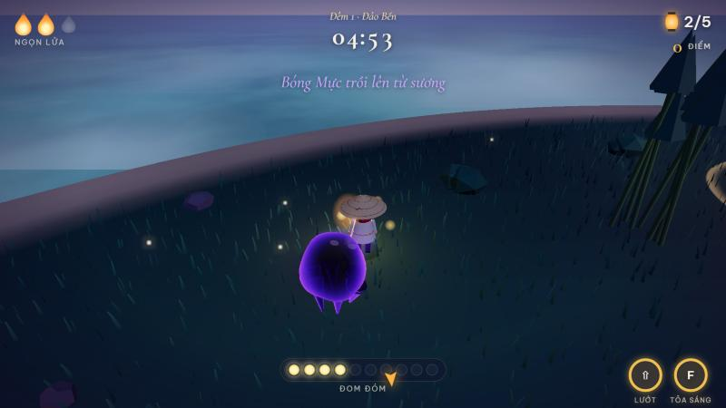

# Đảo Đèn Lồng

> Video demo: *(sẽ thêm ở Phase 4)* · Tài liệu lab gốc: [LAB.md](LAB.md)

Game 3D góc nhìn thứ ba. Mây, người giữ đèn nhỏ tuổi đội nón lá, chạy khắp Đảo Bến gom đom đóm để thắp lại 5 Đèn Lồng Lớn, né lũ Bóng Mực trong sương đen. Bản web dùng Three.js; logic game là một lõi mô phỏng tất định chạy được cả trong trình duyệt lẫn Node (headless).




## Cài đặt và chạy (macOS / Linux / Windows, cần Node ≥ 18)

```bash
npm ci
npm start
```

Trình duyệt mở `http://localhost:5173`. Bản tĩnh để phát hành: `npm run build` → thư mục `dist/`.

## Điều khiển

| Phím | Hành động |
|---|---|
| W A S D / mũi tên | Di chuyển (theo hướng camera) |
| Chuột (bấm vào màn hình để khóa chuột) | Xoay camera · lăn chuột để zoom |
| Space | Nhảy |
| Shift | Lướt |
| E | Nạp đom đóm vào đèn (khi đứng trong 2 m) |
| F / chuột phải | Tỏa Sáng (tốn 3 đom đóm) |
| Esc / P | Tạm dừng (âm lượng, độ nhạy chuột) |
| M | Tắt/bật tiếng |

## Luật và cách tính điểm (Phase 1)

- Mang tối đa 10 đom đóm. Mỗi đèn cần 10 đom đóm, nạp nhiều lần được, đèn nhớ tiến độ.
- Bóng Mực chạm vào: −1 Ngọn Lửa, rơi một nửa số đom đóm đang mang ra xung quanh (nhặt lại được trong 8 s), bất tử 1.5 s.
- Rơi khỏi đảo: −1 Ngọn Lửa, mất hết đom đóm, hồi sinh ở giữa đảo sau 1 s.
- Tỏa Sáng: tốn 3 đom đóm, hồi chiêu 3 s, choáng mọi Bóng Mực trong 5 m trong 2 s và đẩy lùi 4 m.
- Đèn đã sáng tạo vùng an toàn bán kính 6 m, Bóng Mực không vào được.
- **Thắng:** thắp đủ 5 đèn. **Thua:** hết 3 Ngọn Lửa, hoặc hết 300 s (trời sáng).

| Sự kiện | Điểm |
|---|---|
| Mỗi đom đóm nạp vào đèn | +10 |
| Mỗi đèn được thắp | +100 |
| Mỗi Bóng Mực trúng Tỏa Sáng | +5 |
| Khi thắng: mỗi giây còn lại (làm tròn xuống) | +2 |
| Khi thắng: mỗi Ngọn Lửa còn lại | +50 |

## Chế độ headless (Test Contract v1.0)

```bash
node tools/headless.mjs --seed 1 --night 1 --ticks 18000 --out out.jsonl [--scenario s.json] [--inputs i.json] [--snapshot-every 10]
```

- Khai báo đầy đủ trong [game.contract.json](game.contract.json). Các số `tuning` được đọc trực tiếp từ [src/sim/config.js](src/sim/config.js); test kiểm tra hai nơi luôn khớp nhau.
- Logic chạy 60 tick/giây, không cần cửa sổ hay GPU; một Đêm đầy đủ (18 000 tick) chạy xong dưới 1 giây.
- Sai định dạng file inputs/scenario → mã thoát 2; lỗi khác → mã thoát 1; thông báo ra stderr.
- Snapshot có thêm mảng `motes` (khuyến nghị của v1.0).

## Test

```bash
npm test
```

19 scenario headless chạy qua đúng lệnh CLI: tính tất định, di chuyển và xoay camera, nhặt, nạp đèn từng phần, thắng/thua, Tỏa Sáng, bị chạm, vùng an toàn, rơi khỏi đảo, lịch sinh Bóng Mực, mã thoát 2, tốc độ chạy.

## Giả định (chỗ PRD-0 còn mơ hồ)

- Dùng ngay bộ số chuẩn của Ticket-02 (tốc độ 6 m/s, nhảy 7 m/s, trọng lực −20 m/s², sức chứa 10, chi phí đèn 10, Tỏa Sáng 3 / 5 m / 3 s…) và bản đồ chuẩn Đêm 1 (đảo tròn bán kính 40 m, 5 đèn, 24 điểm sinh đom đóm, 12 điểm sinh Bóng Mực).
- Bóng Mực mới sinh có trạng thái `spawning` 30 tick (không gây sát thương), sau đó `wander` (đi lang thang 2 m/s tới điểm ngẫu nhiên theo seed), `chase` khi Mây trong 12 m (4 m/s), bỏ đuổi khi xa hơn 18 m. Sau khi chạm Mây chuyển `recoil` (lùi 2 m trong 60 tick). Bóng Mực do scenario đặt vào bắt đầu ở `wander`.
- Bóng Mực có tâm ở độ cao 1.0 m; chạm khi khoảng cách XZ ≤ 1.0 m và chênh cao ≤ 1.5 m.
- Lướt (dash) đã có: 14 m/s trong 0.2 s, hồi chiêu 1.5 s; phát sự kiện `dash`.
- Đèn đặt sẵn `lit: true` trong scenario được coi như đã nạp đủ (`deposited = 10`).

## Cấu trúc

```
src/sim/      lõi mô phỏng tất định (config, rng, sim) — dùng chung cho game và headless
src/game/     phần hiển thị Three.js: world, actors, audio, HUD, main
tools/        headless.mjs (CLI theo Test Contract)
tests/        scenario headless (node:test)
```

## Sáng tạo của tôi

- **Đảo sống động:** biển mây chuyển động bằng shader, mây bồng bềnh quanh đảo, bầu trời có trăng và sao lấp lánh, dải sáng ấm ở chân trời mạnh dần theo số đèn đã thắp, sương đen tím tan dần khi đảo sáng lên.
- **Bến gỗ và con thuyền nhỏ** ở mép đảo (đúng tên "Đảo Bến"), cỏ lay theo gió, khóm tre, lối đá dẫn tới từng đèn.
- **Đom đóm đang mang bay quanh Mây**, đèn đã sáng có đom đóm trang trí lượn quanh.
- **Âm thanh tự tổng hợp** bằng WebAudio (không dùng file ngoài): nhạc nền pad đêm, tiếng nhặt theo thang ngũ cung, chuông khi thắp đèn, tiếng tỏa sáng, bị chạm, Bóng Mực xuất hiện, đếm ngược 10 s cuối.
- Mọi phần trên chỉ nằm trong `src/game/` (hiển thị), không chạm tới `src/sim/`, nên đầu ra headless không đổi. Bằng chứng: `npm test` vẫn đạt toàn bộ, và test tất định so sánh từng byte hai lần chạy.
